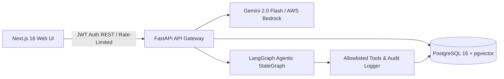
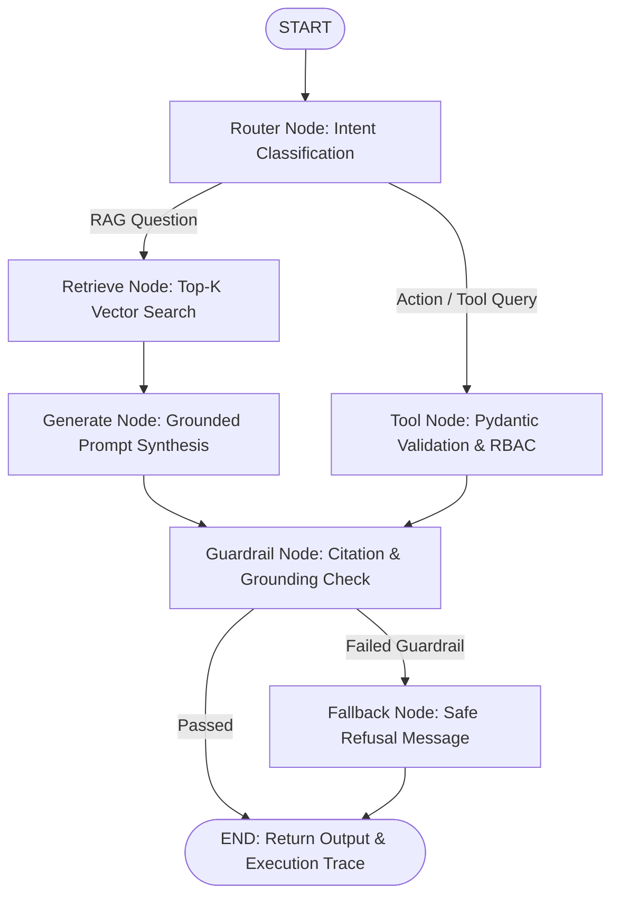

# Enterprise Knowledge Intelligence Assistant (EKIA)

[](https://github.com/kamalpraneeth/enterprise-knowledge-intelligence-assistant/actions/workflows/ci.yml)
[](https://fastapi.tiangolo.com)
[](https://nextjs.org)
[](https://github.com/pgvector/pgvector)
[](https://ai.google.dev)
[](https://aws.amazon.com/bedrock/)
[](docs/AGENT_GRAPH.md)

**Enterprise Knowledge Intelligence Assistant (EKIA)** is a production-grade Generative AI and Decision Science application built for high-reliability enterprise document querying, compliance policy navigation, and agentic task execution.

---

## 🏢 Business Problem & Objective

Modern enterprises suffer from critical information bottlenecks and compliance vulnerabilities:
1. **Knowledge Fragmentation**: Internal policies, security protocols, and operational workflows are scattered across disjointed static files (PDFs, DOCX, intranet handbooks), making manual discovery slow and error-prone.
2. **Generative Hallucination Risk**: Unconstrained off-the-shelf LLMs frequently generate fabricated policies, false expense limits, or inaccurate security guidelines, exposing organizations to audit failures and financial liability.
3. **Lack of Auditable Grounding**: Enterprise decisions require exact source verification. Without granular document and page-level citations, staff cannot verify generated answers.
4. **Uncontrolled Tool Execution**: Conversational agents that execute corporate actions (e.g., ticket creation, SQL lookups) without strict Role-Based Access Control (RBAC) and schema validation pose severe operational risks.

### EKIA Solution
EKIA solves these challenges with a defense-in-depth architecture:
- **Verified Grounded RAG**: Answers synthesized exclusively from retrieved knowledge base chunks with strict bracketed citations (`[Source 1]`) and page numbers.
- **Pre-Ingestion Knowledge Validation**: Document quality gate (`scripts/validate_kb.py`) enforcing size limits, metadata headers, duplicate IDs, and **TF-IDF cosine similarity deduplication** before embedding generation.
- **Typed Agentic Orchestration**: LangGraph `StateGraph` state machine coordinating intent routing, retrieval, generation, allowlisted tools with Pydantic validation, and post-generation guardrails.
- **Multi-Cloud LLM Flexibility**: Modular provider abstraction supporting Google Gemini 2.0 Flash and AWS Bedrock (Claude 3 Haiku / Titan) using the default AWS IAM credential chain with zero hardcoded secrets.

---

## 🏛️ System & Agentic Architecture

### 1. High-Level System Architecture


### 2. LangGraph Agent Orchestrator (`AGENT_ORCHESTRATOR=langgraph`)
When enabled via `AGENT_ORCHESTRATOR=langgraph`, execution follows a deterministic, typed `StateGraph`:


*For complete StateGraph specification, type schemas, and conditional transitions, see [`docs/AGENT_GRAPH.md`](docs/AGENT_GRAPH.md).*

---

## 🚀 Quick Start (Docker Compose)

Launch the entire multi-container stack locally with Docker Compose:

```bash
# 1. Clone the repository
git clone https://github.com/kamalpraneeth/enterprise-knowledge-intelligence-assistant.git
cd enterprise-knowledge-intelligence-assistant

# 2. Copy and configure environment variables
cp .env.example .env

# 3. Start all services via Docker Compose
docker compose up --build -d
```

### Access Points
- **Frontend Web UI**: [http://localhost:3000](http://localhost:3000)
- **FastAPI Interactive Docs**: [http://localhost:8000/docs](http://localhost:8000/docs)

### Pre-Configured Demo Accounts (Role-Based Access Control)
| Role | Email | Password | Permissions |
| :--- | :--- | :--- | :--- |
| **Admin** | `admin@ekia.local` | `AdminPass123!` | Document upload/delete, full tool execution, user management |
| **Knowledge Manager** | `km@ekia.local` | `KMPass123!` | Document ingestion, knowledge base inspection, standard queries |
| **Employee** | `employee@ekia.local` | `EmployeePass123!` | Querying, personal support tickets (upload blocked by RBAC) |

---

## 📊 RAG Quality Benchmark Results

> **Evaluation Run Metadata:** Mode: `mock` (Deterministic evaluation with in-memory vector index) | Date: 2026-10-10 | Models: `gemini-2.0-flash` & `models/gemini-embedding-001` | Commit: `86fa3a2`  
> *Note: Live evaluation mode (`--mode live`) requires a user Gemini API key and has not yet been run.*

| Metric | Measured Score | Target | Notes |
| :--- | :--- | :--- | :--- |
| **Retrieval Hit Rate** | **45.0%** | > 80.0% | Target document chunk found in top-5 retrieval |
| **Citation Validity** | **100.0%** | > 95.0% | Citations point to verified context chunks |
| **Groundedness Score** | **48.2%** | > 70.0% | Recall of expected factual terms |
| **Refusal Defense Rate** | **10.0% (v1) / 40.0% (v2)**| > 90.0% | Correct refusal of adversarial/unanswerable queries |
| **Overall Pass Rate** | **16.7% (v1) / 26.7% (v2)**| > 75.0% | Questions meeting all RAG criteria simultaneously |
| **Mean Latency** | **4.9 ms** | < 1200 ms | Average end-to-end execution time in mock environment |
| **P95 Latency** | **5.8 ms** | < 2000 ms | 95th percentile execution latency |

To run the automated empirical benchmark:
```bash
python evals/eval_runner.py --mode mock
# For live evaluation with Gemini API key:
python evals/eval_runner.py --mode live
```
Detailed evaluation logs and prompt comparisons are recorded in [`docs/PROMPT_LOG.md`](docs/PROMPT_LOG.md) and [`docs/EVALUATION.md`](docs/EVALUATION.md).

---

## ⚠️ Technical Limitations & Honest Boundaries

1. **Mock vs. Live Evaluation**: In CI and local test environments without cloud keys, the evaluation runner executes in deterministic `mock` mode. The reported scores reflect the baseline capabilities of the mock generator and test prompts; real-world generation metrics must be measured using `--mode live`.
2. **Vector Indexing**: When running unit tests or offline without PostgreSQL, the system falls back to an in-memory NumPy/Python cosine retriever. In production with PostgreSQL, pgvector HNSW indexing provides indexed similarity search.
3. **Single EC2 Deployment**: The low-cost deployment guide in [`docs/DEPLOYMENT.md`](docs/DEPLOYMENT.md) targets a single `t3.medium` instance. It is cost-efficient (~$30/mo) but lacks multi-region failover. The full Terraform stack in `infra/terraform/` provides high availability but incurs significant cloud costs (NAT Gateways, RDS Multi-AZ).
4. **Document Formats**: File parsing supports clean TXT, Markdown, and standard text PDFs via `pypdf`. Scanned documents requiring Optical Character Recognition (OCR) are currently outside the scope of the pipeline.

---

## 📂 Repository Structure

```
├── backend/
│   ├── app/
│   │   ├── agents/       # LangGraph StateGraph orchestrator (graph.py)
│   │   ├── api/          # FastAPI routers (auth, chat, retrieval, tools, evals)
│   │   ├── core/         # Config, security, JWT, rate limiting, logging
│   │   ├── db/           # Async SQLAlchemy session and seed data (seed.py)
│   │   ├── models/       # Database models (User, Document, Chunk, QueryLog)
│   │   ├── rag/          # Versioned prompts (answer_v1/v2), chunker, retriever
│   │   ├── services/     # Ingestion pipeline, embeddings, LLM (Gemini & Bedrock)
│   │   └── tools/        # Allowlisted agent tools with Pydantic schemas and RBAC
│   ├── demo_documents/   # Synthetic company policy documents (HR, IT, Travel)
│   ├── tests/            # Pytest suite (69 tests covering auth, RAG, agents, Bedrock)
│   ├── Dockerfile        # Backend container definition
│   └── requirements.txt  # Pinned backend dependencies
├── frontend/
│   ├── app/              # Next.js App Router (Landing, Auth, Dashboard subpages)
│   ├── components/       # UI components (Header, Sidebar)
│   └── package.json      # Frontend dependencies
├── evals/
│   ├── datasets/         # 30-question evaluation dataset
│   ├── reports/          # Evaluation report runs (JSON & Markdown)
│   └── eval_runner.py    # Empirical RAG evaluation CLI
├── scripts/
│   └── validate_kb.py    # Pre-ingestion knowledge validation (TF-IDF deduplication)
├── docs/
│   ├── AGENT_GRAPH.md    # LangGraph StateGraph specification
│   ├── ARCHITECTURE.md   # System architectural blueprints
│   ├── API.md            # REST API specifications
│   ├── DEPLOYMENT.md     # Single EC2 + IAM role guide, cost warnings, teardown checklist
│   ├── EVALUATION.md     # RAG evaluation methodology
│   ├── FINDINGS_REPORT.md# Audit findings, bug fixes, and verification results
│   ├── JD_TRACEABILITY.md# Job description requirement mapping matrix
│   └── PROMPT_LOG.md     # Prompt v1 vs v2 empirical comparison
├── docker-compose.yml    # Multi-container orchestration
└── README.md
```

---

## 📄 License
This project is licensed under the MIT License.
