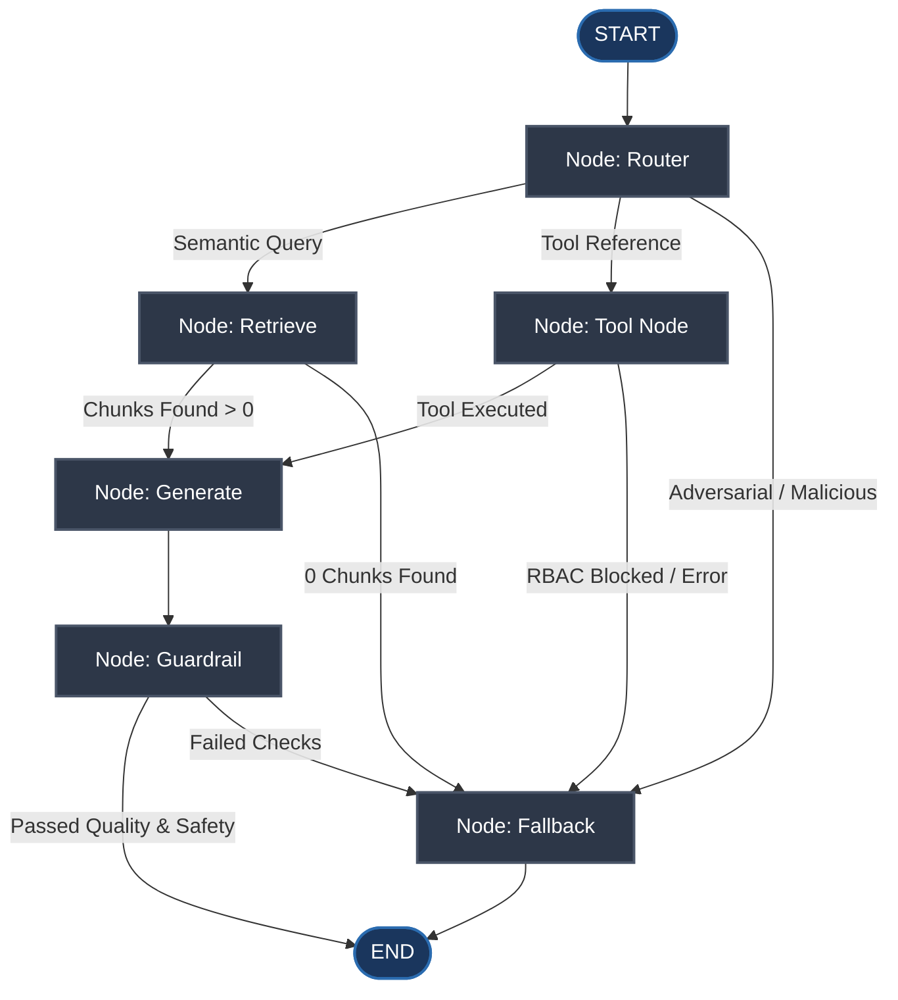

# EKIA Agent Orchestrator: LangGraph StateGraph Architecture

This document describes the typed **LangGraph StateGraph** agent layer implemented in `backend/app/agents/graph.py`.

---

## 1. Graph Flowchart (Mermaid)



---

## 2. Node Specifications

| Node | Input State Dependencies | Responsibility | Output Mutation |
| :--- | :--- | :--- | :--- |
| **`router`** | `question`, `user_role` | Dispatches query to retrieval, tool invocation, or guardrail rejection based on intent and security markers. | `next_action`, `tool_name`, `trace` |
| **`retrieve`** | `question`, `db` | Executes semantic vector retrieval against indexed enterprise document chunks with score thresholding. | `context_chunks`, `has_sufficient_evidence`, `next_action`, `trace` |
| **`tool_node`** | `tool_name`, `tool_arguments`, `user_role` | Enforces Pydantic argument validation and Role-Based Access Control (RBAC). Executes registered tools (`search_knowledge_base`, `lookup_policy_record`, `get_document_metadata`, `create_support_request`). | `tool_result`, `next_action`, `trace` |
| **`generate`** | `context_chunks`, `tool_result` | Formats context and executes configured LLM (`GeminiLLMProvider` or Bedrock/Mock) with versioned prompt template. | `draft_answer`, `citations`, `next_action`, `trace` |
| **`guardrail`** | `draft_answer`, `context_chunks` | Validates citation indexes against retrieved documents, filters hallucinations, and screens for sensitive tokens. | `final_answer`, `status`, `next_action`, `trace` |
| **`fallback`** | `state` | Delivers standard enterprise insufficient-evidence refusal response without exposing internal error details. | `final_answer`, `status="fallback"`, `trace` |

---

## 3. Configuration & Orchestrator Switch

Orchestration is configurable via the environment variable `AGENT_ORCHESTRATOR`:
- `AGENT_ORCHESTRATOR=custom` (Default): Uses the direct linear RAG pipeline (`backend/app/rag/pipeline.py`).
- `AGENT_ORCHESTRATOR=langgraph`: Delegates query processing to `backend/app/agents/graph.py` StateGraph with full node tracing and dynamic tool execution.

---

## 4. Returned Execution Trace

Every graph run returns an immutable execution trace documenting each node visited, latency in milliseconds, and transition decisions:

```json
[
  {
    "node": "router",
    "decision": "retrieve",
    "tool_selected": null,
    "duration_ms": 0.45
  },
  {
    "node": "retrieve",
    "chunks_count": 5,
    "has_sufficient_evidence": true,
    "duration_ms": 3.82
  },
  {
    "node": "generate",
    "draft_length": 214,
    "citations_count": 1,
    "duration_ms": 0.12
  },
  {
    "node": "guardrail",
    "passed": true,
    "reason": "Passed all checks",
    "duration_ms": 0.08
  }
]
```
